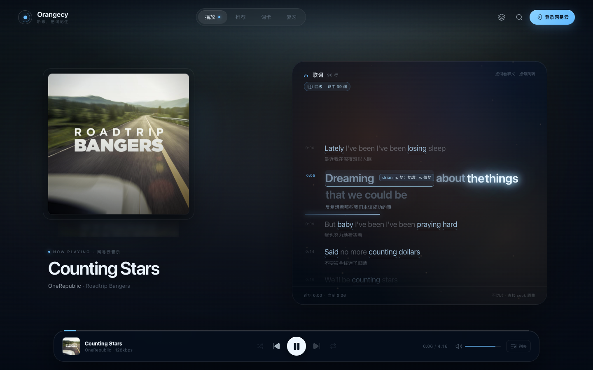
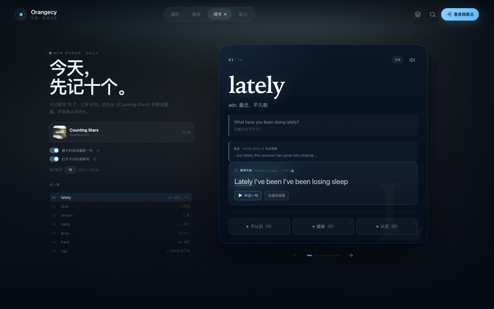
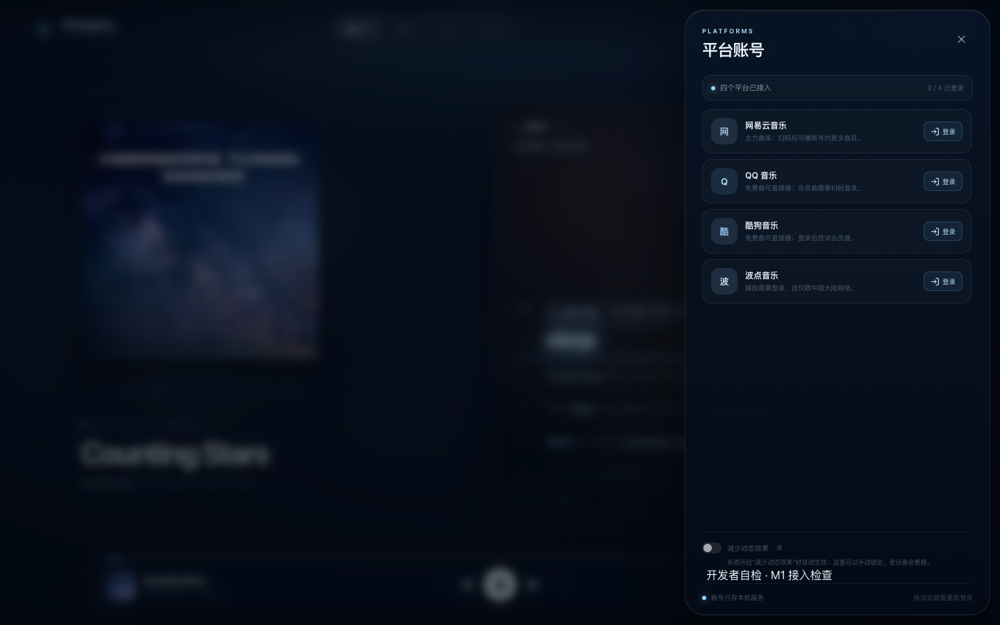
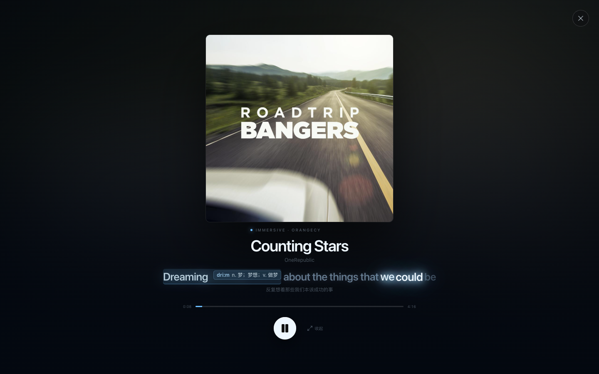
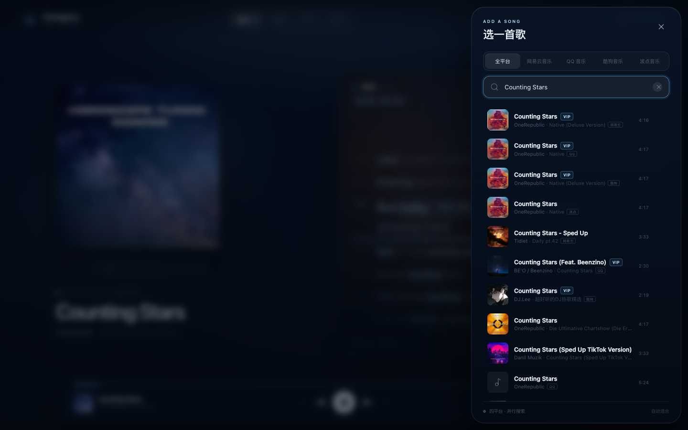
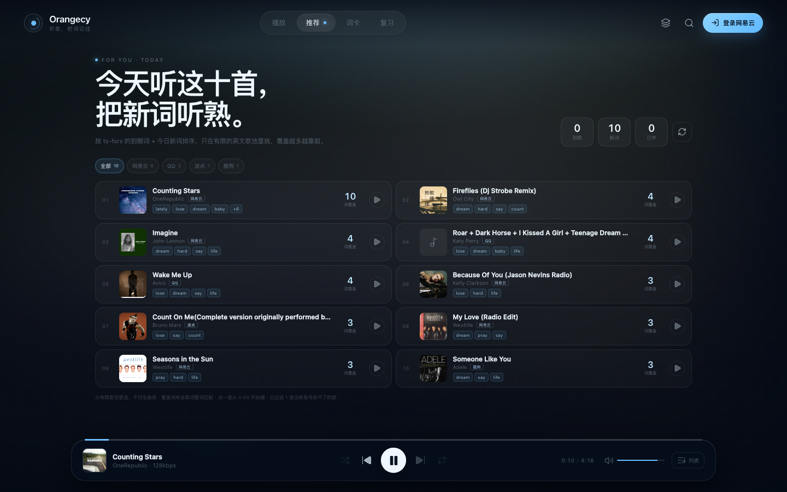
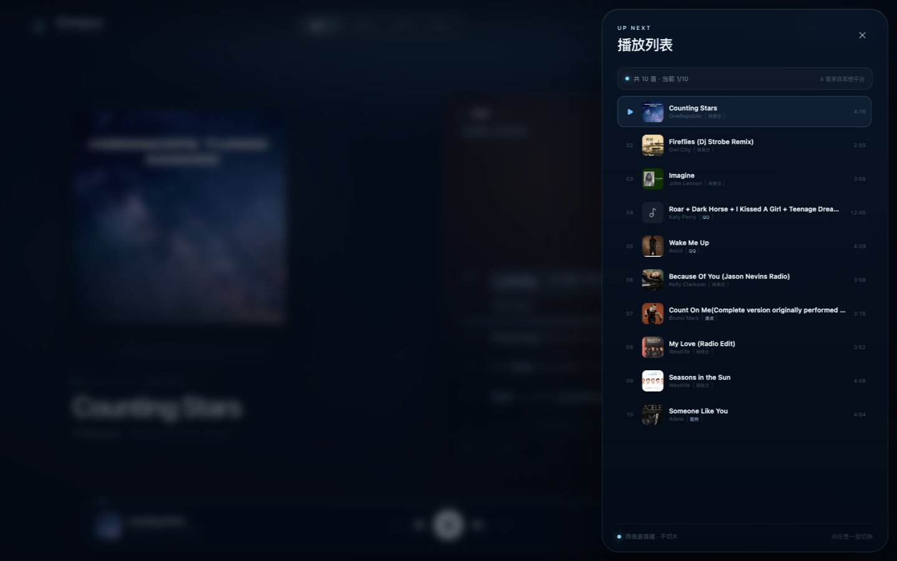
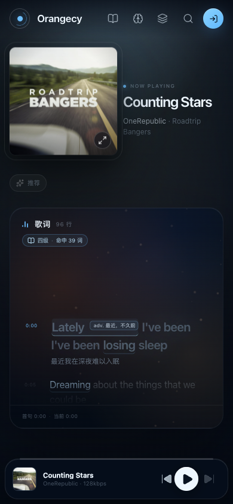
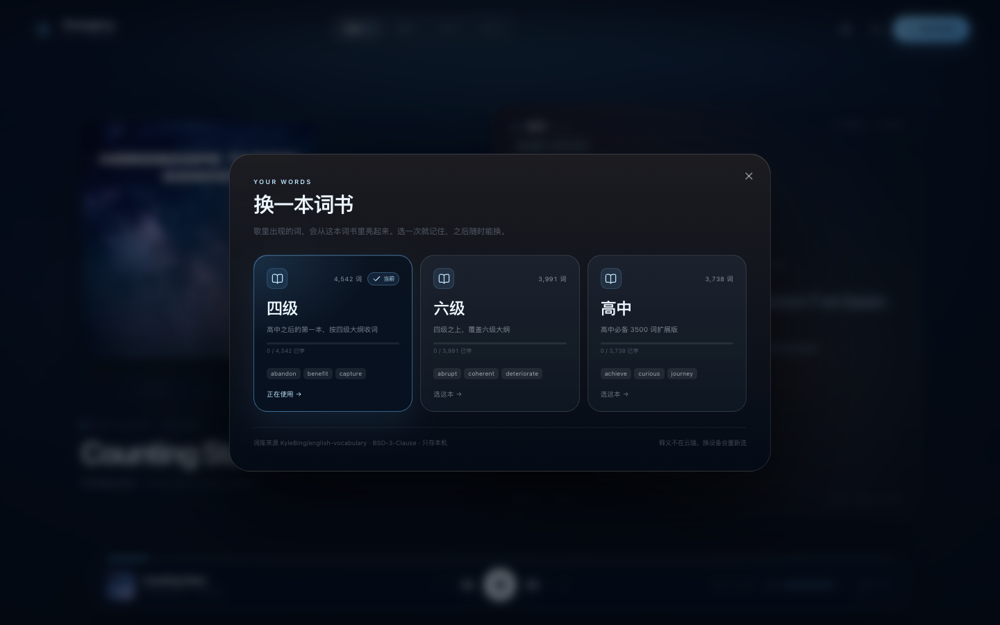

# Orangecy · 网站测试版

> 在听歌的时候背单词。需求唯一来源：桌面 `OrangecyPRD.md`；协议规则：`Folia-协议分类清单.md`。
> 本仓库只重写实现，**没有复制 Folia（AGPL）的任何代码**。

当前进度按 PRD 附录 F 推进：第 5 步（ts-fsrs + 每日新词 + 到期复习 + 反向索引推荐）已完成；第 6 步做了第一版轻量 Canvas 歌词氛围层（含减少动态效果与自动降级），以及封面飞入/滑动手势；完整的 Pixi/R3F 歌词舞台和旧机 60 帧实测还没做完。平台已接网易云、QQ 音乐、酷狗音乐、波点音乐；波点协议是按需求独立重写的，没有安装 AGPL 库。

## 现在能做什么

- **平台验证（M1）**：网易云扫码登录 → 搜索歌曲 → 拿到带时间戳的 LRC → 点击歌词从指定秒数播放。登录凭据只留在本机服务。
- **全平台搜索**：搜索默认并行查网易云 / QQ / 酷狗 / 波点，结果按平台轮转混合并标出平台；点任意一首直接进播放器，队列也保留混合平台。
- **歌词渲染优化**：歌词行用 memo，播放时只让当前句跟随时间刷新，其他行跳过重渲染；390px 手机视口 + Chrome 6× CPU 限速模拟下约 108fps、最大帧 35ms（真机仍待实测）。
- **QQ 音乐**：搜索面板可切到 QQ 音乐，搜歌、读带时间戳歌词、看词高亮；QQ 免费曲实测可以完整播放（本机 Range 代理），会员曲扫手机 QQ 登录后走 QQ 播放地址。
- **酷狗音乐**：搜索面板可切到酷狗，设备注册后免费曲实测可以完整播放（本机 Range 代理），KRC 解码为带逐词时间的 LRC；打开酷狗 App 扫码后账号 token 只存本机服务，会员曲会尝试用账号权限播放。
- **波点音乐**：独立重写的 Bodian 协议，支持搜索、逐词歌词、扫码登录和免费完整曲播放；免费英文歌可匿名播放，会员曲需要登录。未安装/未复制 AGPL 的 `bodian-music-api`。
- **播放器 + 歌词（M2）**：全屏沉浸式播放器、封面取色背景、玻璃质感控制条、逐行高亮、点击歌词 seek、Range 流式代理（不切片、不落盘）。
- **词书 + 匹配（M3）**：首次打开选四级 / 六级 / 高中词书，卡片显示每本“已学 / 总数”进度；歌词整词匹配（含常见词形还原），词书里的词在歌词中高亮；点词显示音标、词性释义、例句，并从该句起播。
- **歌词内词性词义（M6）**：当前播放句的第一个命中词会直接在歌词里展开「词性 + 中文义」，其余命中词保留蓝色下划线；标注可点击，仍会 seek 到该句并打开完整词卡。
- **逐词三态（M6）**：有逐词时间戳的歌（网易云 YRC、酷狗 KRC、波点 AWLRC）把每个词分成 waiting / singing / sung：未唱低透明、正在唱最亮并带蓝色光晕、唱过回到中等蓝；没有逐词数据时干净退回逐行，不硬凑。
- **词卡 + 片段播放（M4）**：卡片含音标、词性释义、近义词、例句、真题句（四级/六级）和歌词原句；翻卡时从对应歌词句开始播；三档反馈“不认识 / 模糊 / 认识”直接交给 ts-fsrs。
- **词卡里的“后台播放器”**：词卡/复习模式隐藏底部播放条，只留带光效的“歌词片段”和播放中的小波形；用户看不到播放器画面，点「听这一句」直接在原曲对应秒数播放，点「去播放器看」才回到完整播放器。
- **复习（M5）**：每天新词默认 10 个（5/10/15/20/30 可调），优先从正在听的歌里提；三档反馈用 ts-fsrs 算出下一次间隔；顶栏「复习」显示到期数量，到期卡可以直接复习。被动词看到歌词不算复习，只有点三档按钮才推进算法。
- **每日推荐（M5）**：把到期词 + 今日新词发给本机推荐池，按“覆盖词数”从有限英文歌池里挑最多 10 首；池子现在混合网易云 / QQ / 酷狗 / 波点免费英文歌，每张卡标出平台；**展示前逐首按平台检查播放地址，过滤当前账号放不了的歌**，过滤后的数量会写在列表底部；点一首就从播放器播放，歌里仍保留词高亮。
- **歌词舞台氛围（M6 第一版）**：歌词面板内一层轻量 Canvas：冷蓝光团 + 尘埃粒子；播放时才跑，暂停/切后台/减少动态效果时停；帧时间过长会自动减粒子甚至回到静态。
- **封面飞入 + 手势（M6）**：点封面右下角「放大」或上滑封面，封面用 Motion 共享元素飞入沉浸页；左右滑封面 seek/切歌；Esc 或「收起」返回。沉浸页里保留播放、进度和当前歌词。
- **沉浸页词性词义**：沉浸页当前歌词里的目标词同样高亮，第一个命中词直接展开「词性 + 中文义」，有逐词时间时当前词也会单独亮起；和主播放器保持一致。
- **词卡自动开播**：进入词卡或翻到下一张时，若「翻卡时自动播那一句」开着，会在 650ms 后自动播放原曲对应片段；播放器条保持隐藏。
- **自动发音**：词卡新增「打开卡片时读单词」开关（默认开），翻卡时先读单词，再播原曲片段；手动点卡片右上角喇叭仍可随时重读。
- **逐句进度条（M6）**：当前歌词下方有一条随播放进度填充的蓝色细线，seek 时立即更新，让歌词高亮和真实播放位置保持同一节奏。
- **蓝白舞台（2026-10-21）**：主色改为深蓝底 + 冰蓝 / 白，移除橙/金主高亮；顶栏的接入检查、平台文字胶囊、曲目状态徽章和调试检查条默认收起，平台入口收成 Layers 图标，接入检查移到平台账号抽屉的「开发者自检」。
- **平台账号中心**：点 TopBar 的平台胶囊（手机端是 Layers 图标）打开四平台账号抽屉，能看到每个平台的登录态、账号昵称和登录/退出入口；每次打开会重新校验四个平台的登录态，过期 token 不会再显示成“已连接”。
- **减少动态效果**：平台账号抽屉里有手动开关；开启后 Canvas 氛围层停在静态图，CSS 动画和过渡关闭，设置持久化。系统偏好开启时也会自动生效。
- **播放队列抽屉**：底部的「列表」打开当前队列，显示当前曲目、顺序、平台来源、时长；混合平台推荐会显示「N 首来自其他平台」，点任意一首直接切换。
- **首屏按需加载**：播放器首屏只加载核心代码；推荐、词卡、复习、搜索和四个登录弹窗都改成 lazy chunk，首次打开时再加载。主 JS 从约 500KB 降到 445KB，去掉了 Vite 的 500KB 警告。
- **推荐平台筛选**：混合推荐支持「全部 / 网易云 / QQ / 酷狗」筛选，并显示每个平台当前有几首；只登录某个平台时可以快速看能播的歌。

## 验收

- 完整验收矩阵、人工扫码步骤和已知限制见 [docs/ACCEPTANCE.md](docs/ACCEPTANCE.md)。
- 启动生产服务后执行 `npm run smoke`，最近一次为 **12/12 通过**。

## 预览

| 播放器 + 逐词三态 | 词卡模式 |
|---|---|
|  |  |

| 四平台账号中心 | 沉浸页 |
|---|---|
|  |  |

| 全平台搜索 | 混合推荐 |
|---|---|
|  |  |

| 播放队列 | 手机播放器 |
|---|---|
|  |  |



## 目录

```
server/
  index.mjs                 Express BFF：会话、扫码登录、搜索、歌词、音源、Range 代理、静态站点
  providers/netease.mjs     网易云 provider（MIT 接口库，非官方接口）
  catalog.mjs               推荐池构建 / 反向索引 / 推荐排序
  scripts/build-cross-catalog.mjs  把 QQ / 酷狗免费曲并入推荐池
  qqSidecar.mjs             QQ 音乐 sidecar 启动 / 代理
  providers/qq.mjs          QQ 音乐 provider（扫码、搜索、歌词、播放）
  providers/kugou.mjs       酷狗 provider（设备注册、搜索、歌词、免费曲播放）
  providers/bodian.mjs      波点 provider（独立重写协议：搜索、歌词、扫码、播放）
  lemma.mjs / lyrics.mjs    服务端词形还原 + LRC 解析
src/
  components/               播放器、歌词舞台、词卡、搜索/登录/检查抽屉
  lib/lrc.ts                LRC 时间戳 + 翻译 + 逐字标签解析，过滤制作人员行
  lib/wordbook.ts           词书加载、词形还原、整词匹配、内存缓存
  lib/srs.ts                ts-fsrs 调度、每日新词、到期队列、本地存储
  studyStore.ts             学习状态与计数（zustand）
  player.ts                 单例 Audio 控制器（seek / 播放 / 音量 / Media Session）
  store.ts                  zustand 状态
public/wordbooks/           四级 / 六级 / 高中压缩词书（约 600KB/本）
data/                       运行时会话（含平台 cookie）与推荐池缓存（已被 .gitignore 忽略）
scripts/build-catalog.mjs   手动重建推荐池
```

## 关键实现说明

- **不切片、不存副本**：`/api/audio/:id` 按浏览器 Range 请求转发原曲，服务端只做流式代理；seek 是 `audio.currentTime`，没有任何剪切文件。
- **登录态**：浏览器只拿到 HttpOnly 的 `oc_sid`；平台 cookie 存在服务端 `data/sessions.json`，不返回给前端。
- **歌词匹配**：LRC 提供行级时间戳；对每行做英文整词切分，再按词书查词（含 `-s/-ed/-ing/-ies/ves` 与常见不规则动词还原），命中的词记录 `词 → 歌 → 句 → 秒`。运行时按歌曲 + 词书缓存。
- **复习**：`ts-fsrs` 关闭短时学习步，三档映射为 Again / Hard / Good；新词首次评分后按天排期，到期词进入「复习」。学习状态只存在浏览器 `localStorage`（`orangecy.study.v1`），换浏览器/清缓存会丢，和 PRD 的“只存本机”一致。
- **推荐池**：`server/catalog.mjs` 用有限的英文歌种子搜索可播曲目，只保留每首歌的“词 → 时间 → 一行歌词”索引（不存完整歌词、不存音频）。本机当前缓存 15 首；缓存不存在时会自动在后台重建，也可以 `npm run catalog` 手动重建。
- **词书**：只从公开词书数据生成，不爬任何商业 App 的释义/例句；近义词和真题句也来自同一份 BSD-3-Clause 词库，扇贝只借鉴卡片字段结构。
- **动效**：页面切换、抽屉、翻卡用 Motion；封面放大用 `layoutId` 共享元素；歌词高亮用 CSS；歌词面板背景是轻量 Canvas 2D（`LyricAura`）。它只在播放时跑，DPR 上限 2，`prefers-reduced-motion` 只画静态帧，帧时间过长会自动降级。桌面 headless 6× CPU throttle 下 rAF 仍高于 60fps，真机 60 帧和完整 Pixi/R3F 舞台仍属于后续。

## 协议与版权

- Folia 及其迁移包为 AGPL-3.0：**只读参考，未复制任何代码，迁移包不在本仓库**。
- 网易云接口库 `@neteasecloudmusicapienhanced/api` 为 MIT，但它是**非官方民间接口**；代码可用不等于平台授权，上架/商用前必须单独评估。
- QQ 音乐接口 sidecar `@yakult-green-tea/qq-music-api` 为 MIT，同样是社区非官方接口；登录后能否播放仍取决于 QQ 账号权限和平台条款。
- 酷狗模块 `kugoumusicapi`（MakcRe/KuGouMusicApi v1.6.0）为 MIT；设备注册与免费曲地址可能随平台策略变化，商用前需单独评估。
- 波点 `bodian-music-api` 是 AGPL：只做了只读协议参考，**没有安装、没有复制代码**；`server/providers/bodian.mjs` 是 Orangecy 的独立重写。播放仅限中国大陆网络，商用前必须单独评估协议与版权。
- 词书数据来自 [KyleBing/english-vocabulary](https://github.com/KyleBing/english-vocabulary)，BSD-3-Clause；完整声明见 `THIRD_PARTY_NOTICES.md` 和 `public/wordbooks/LICENSE-KyleBing.txt`。
- 歌词只在界面显示命中的句子并标注歌名歌手；商用前按 PRD 附录 E 找版权顾问确认。
- 波点音乐（Bodian）接口库是 AGPL：不安装、不复制，将来按需求重写；`@applemusic-like-lyrics/ttml` 同样不装。

## 每日推荐池

推荐只从有限英文歌池里选，不扫全曲库。默认缓存 15 首（Counting Stars、Viva la Vida、Yesterday Once More、Hotel California 等），首次没有缓存时会在后台构建；构建会依次搜索、校验可播、拉 LRC、做整词索引，约 1 分钟。

```bash
npm run catalog     # 强制重建 data/catalog.json
```

## 平台现状

- **网易云**：已接扫码登录、搜索、带时间戳歌词、播放地址和音频代理；M1 三项已在真实接口上验收。
- **QQ 音乐**：已接本机 sidecar、手机 QQ 扫码登录、搜索、歌词、播放地址代理。**免费曲已实测完整播放**；会员曲的登录+播放路径已实现，但本轮无法代替你扫码做会员曲验证。
- **酷狗音乐**：已接设备注册、搜索、歌词解码、免费曲播放地址代理和账号扫码登录；**免费曲已实测完整播放**。会员曲路径已接，但扫码登录后的会员曲播放还没做人工验证。
- **波点音乐**：接口库是 AGPL，按纪律没有安装/复制；`server/providers/bodian.mjs` 是按协议独立重写的客户端。搜索、歌词、扫码 key/等待状态已验证；播放需要登录且仅限中国大陆网络，真实播放还没人工扫码验证。

## 下一步

1. **舞台排版 B**：当前还是封面 + 歌词双栏；下一步做「歌词占满视觉中心」的全屏舞台，封面退到次级。
2. **浮动控件 C**：底部玻璃播放条还在常驻；下一步做闲置自动隐藏的稀疏浮动控件。
3. **真实曲库 D**：登录后仍以 40 首推荐池为主；下一步接平台歌单/日推，登录后展示用户真实可播内容。
4. **四平台登录后的真实播放**：酷狗/QQ 会员曲、波点扫码后的播放需要人工验证。
5. 移动端锁屏/通勤场景留给 iOS 版验证。
