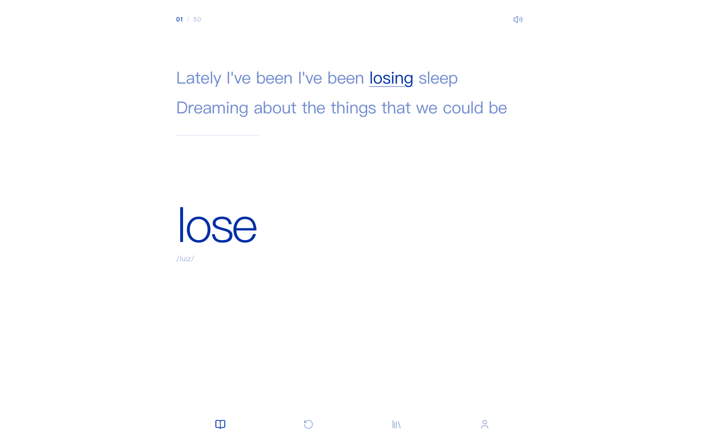
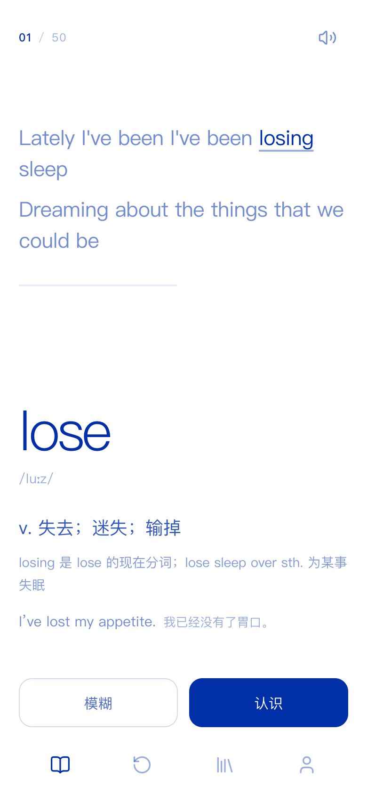

# Orangecy

> 打开 → 一张全屏单词卡 → 背。音乐是隐形弹药，只以卡上十几秒的歌词片段出现。
> 本仓库只重写实现，**没有复制 Folia（AGPL）的任何代码**。

## 产品

Orangecy 是一台纯粹的背单词机器。一轮 50 词，一屏一词：

- 上半屏是这个词在真实歌曲里的 1–2 句歌词，目标词高亮；片段只播一遍。
- 下半屏是单词 + 音标；点卡片空白展开释义 / 知识 / 例句。
- 展开后只有两个判断：**模糊**（hard）/ **认识**（good），直接交给已有 `review()`。
- 点歌词只重播片段；点单词只重听发音；两者不展开词义、不切卡。
- 50 词走完停在 50/50，居中一个重播图标，无文字。
- 底部 4 个纯图标 tab：学习 / 复习 / 词书 / 我的；后三个本轮为空态。

界面上没有歌单、歌曲、播放器、浏览、搜索、抽屉、推荐、弹窗。音乐只以
歌词、目标词、片段进度、静音钮四种痕迹出现。全站只有 `#002FA7` 与
`#FFFFFF` 及透明度派生；白底蓝字，无渐变、无阴影、无第三色。

## 预览

| 桌面 · 收起 | 手机 · 展开 |
| --- | --- |
|  |  |

四态截图在 `docs/screenshots/focus-{desktop,mobile,small}-{collapsed,expanded,playing,muted}.png`；
第一帧见 `focus-first-frame.png`。

## 音频序列

每张卡：

    翻入 320ms → 200ms → 片段 seek + 200ms 淡入 → 歌词逐行点亮 →
    结束前 200ms 淡出 → 暂停 → 500ms 安静 → 单词发音直出（不淡入）→ 静场

- 片段只播一遍；手动重听只重播片段，不触发后续发音 / 自动切卡。
- 静音 = 跳过声音、时间轴照走；默认有声；`orangecy.muted` 持久化。
- 切 tab：200ms 淡出并暂停；回来重开当前卡序列。
- 首启自动播放被浏览器拦住时：时间轴照走、无声；第一次交互后从当前位置
  200ms 淡入补播，不弹提示。
- 浏览器 TTS 无法接 Web Audio 增益，发音 provider 标 `supportsGainRamp=false`；
  0.5s 安静做缓冲，发音直出。后期换真人音频包只换 provider。
- 实测轨迹：`npm run trace:audio` → `docs/audio-trace.json`（13 项断言）。

## 数据

50 张卡 / 17 首真实可播网易云曲目，落在 `public/cards/seed-50.json`，
同内容打包副本 `src/data/seed-50.json`。每张卡：

```ts
type FocusCardData = {
  w: string; p: string; m: string;
  s?: string; syn?: string[]; exam?: [string, string]; k?: string;
  track: Song;
  fragment: {
    trackId: string;
    target: string;
    start: number; end: number;
    lines: { text: string; time: number }[];
  };
};
```

- `npm run cards` 从 `data/catalog.json` + 本地歌词接口生成。
- `npm run build` 先跑 `check:cards`：逐首校验 `/api/song/:id/play` 可播、
  歌词存在、每句时间戳逐行命中、目标词在句内。校验失败构建失败，
  不拿假时间轴补。
- 词义 / 音标 / 例句 / 近义 / 真题来自 CET4 词书（KyleBing，BSD-3-Clause）。
- 学习状态只存在浏览器 `localStorage`（`orangecy.study.v1`）。

## 验收

```bash
npm run typecheck
npm run check:cards     # 需要本地 API 在 8787
npm run build           # 已包含 check:cards
npm run check:palette   # 15 状态 / 0 违规 / 0 渐变 / 0 阴影
npm run smoke           # 58 项
npm run trace:audio     # 0.2s 淡入淡出 / 0.5s 安静 / 发音直出
npm run shoot:focus     # 双端四态截图
```

生产预览：`npm start` 后打开 <http://127.0.0.1:8787>；旧版 8790 端口也可继续
作为静态预览。`npm run dev` 同时起 API 与 Vite。

## 代码地图

```
src/audio/source.ts        音源单例（旧 player 迁入，内核行为不变）
src/audio/store.ts         音频状态（song / lines / playInfo / time / volume / playing）
src/audio/pronunciation.ts browserTts provider
src/audio/sequence.ts      每卡序列器（只调既有 volume / seek / play）
src/lyrics/parse.ts        LRC 解析（旧 lib/lrc 迁入）
src/lyrics/timing.ts       逐词三态（旧 lib/wordTiming 迁入）
src/lyrics/WordHighlight.tsx 词高亮 token 化 / 目标词 / phase
src/cards.ts               卡数据 + SRS 输入适配
src/state/app.ts           view / muted
src/screens/LearnScreen.tsx 卡索引、序列、判断、完成态
src/components/            FocusCard / LyricFragment / FragmentProgress /
                           MuteButton / BottomTabs / PlaceholderView
src/styles/tokens.css      两色 + 明度阶梯
src/styles/app.css         卡面 / tabs / 动效
public/cards/seed-50.json  真实验收数据
server/                    音源代理 / 四平台能力 / 歌词（本轮零改动）
public/wordbooks/          CET4 / CET6 / 高中词书（本轮零改动）
data/catalog.json          曲库索引（本轮零改动）
docs/design/focus-card-v3.md 设计对照
docs/archive/              旧双模式壳 / 旧导航稿 / 旧 CSS / 旧验收
```

## 关键实现

- **只迁未改**：音源、歌词解析、词高亮、TTS 从旧壳原样抽到
  `src/audio` / `src/lyrics`；`srs.ts`、`studyStore.ts`、`wordbook.ts`、
  `api.ts` 与后台零改动。旧壳在新卡建成前仍能跑，旧 smoke 12/12 后才删除。
- **不切片、不存副本**：`/api/audio/:id` 按浏览器 Range 请求转发原曲，
  服务端只做流式代理；seek 是 `audio.currentTime`。
- **登录态**：浏览器只拿到 HttpOnly 的 `oc_sid`；平台 cookie 存在服务端，
  不返回给前端。平台能力只作为音源，不进入界面。
- **动效**：卡片翻入 / 词义展开 / 进度呼吸走 CSS + Motion；
  `prefers-reduced-motion` 时切卡、展开、呼吸归零，音频淡入淡出保留。

## 协议与版权

- Folia 及其迁移包为 AGPL-3.0：**只读参考，未复制任何代码，迁移包不在本仓库**。
- 网易云接口库 `@neteasecloudmusicapienhanced/api` 为 MIT，但它是非官方民间接口；
  代码可用不等于平台授权，上架 / 商用前必须单独评估。
- QQ 音乐 sidecar `@yakult-green-tea/qq-music-api` 为 MIT；登录后能否播放仍取决于
  QQ 账号权限和平台条款。
- 酷狗模块 `kugoumusicapi`（MakcRe/KuGouMusicApi v1.6.0）为 MIT；设备注册与
  免费曲地址可能随平台策略变化，商用前需单独评估。
- 波点 `bodian-music-api` 是 AGPL：只做只读协议参考，**没有安装、没有复制代码**；
  `server/providers/bodian.mjs` 是独立重写。播放仅限中国大陆网络。
- 词书数据来自 [KyleBing/english-vocabulary](https://github.com/KyleBing/english-vocabulary)，
  BSD-3-Clause；完整声明见 `THIRD_PARTY_NOTICES.md` 与
  `public/wordbooks/LICENSE-KyleBing.txt`。
- 歌词只在卡上显示 1–2 句并标注目标词；商用前按 PRD 附录 E 找版权顾问确认。

## 下一步

1. 复习 / 词书 / 我的三个 tab 的真内容（本轮只做空态）。
2. 真人发音音频包 provider（可做真 0.2s 增益斜坡）。
3. 真机首次音频解锁、锁屏 / 通勤场景实测。
