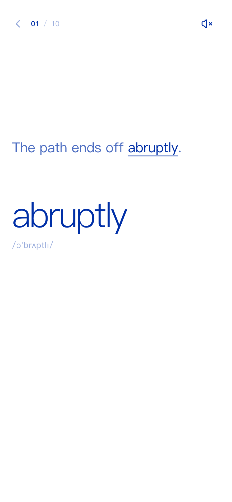
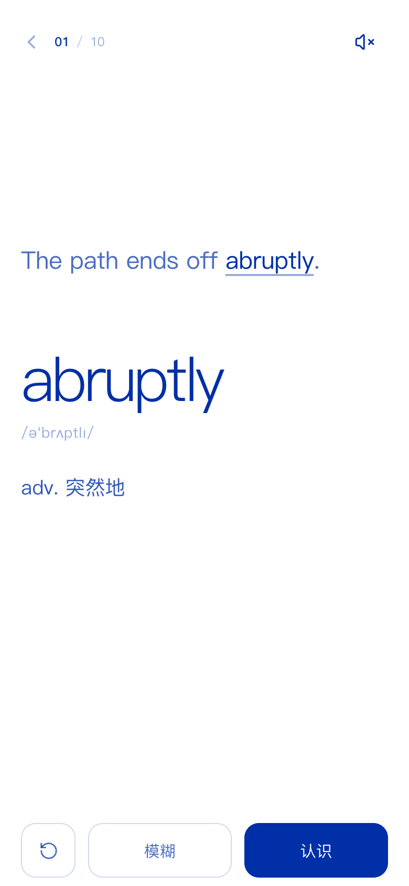
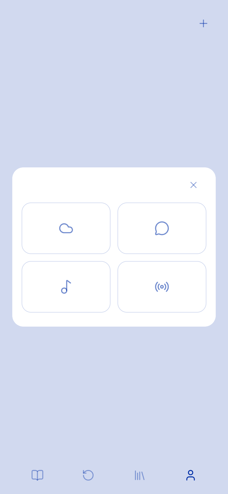
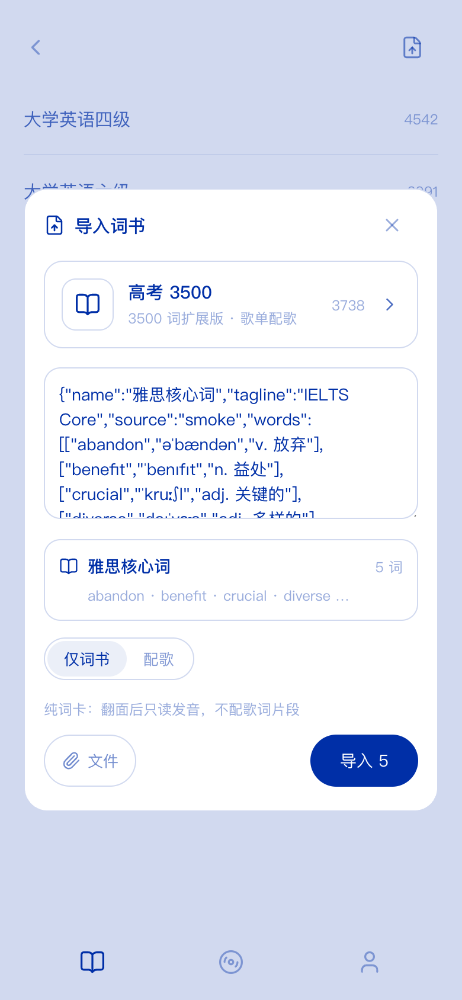
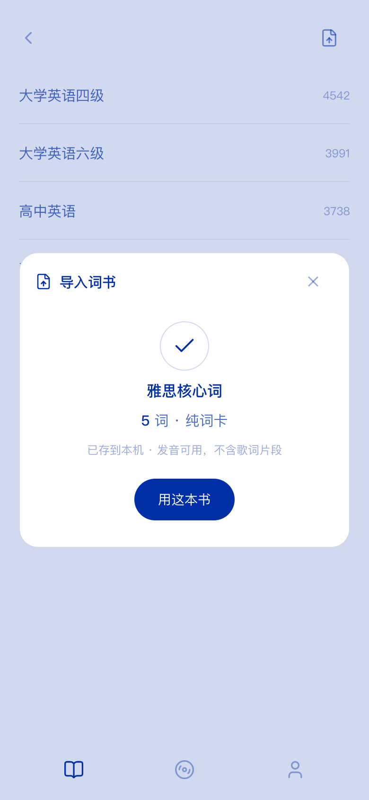
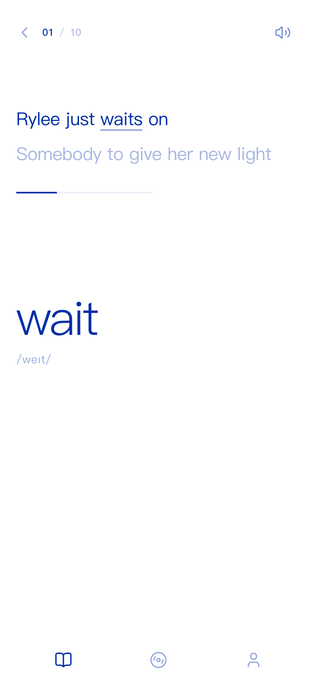
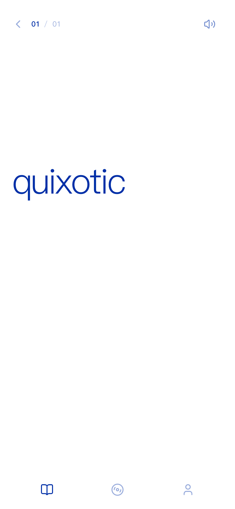

# Orangecy

> 打开 → 一张全屏单词卡 → 背。音乐是隐形弹药，只以卡上十几秒的歌词片段出现。
> 本仓库只重写实现，**没有复制 Folia（AGPL）的任何代码**。

## Live demo

**<https://shrian-z.github.io/Orangecy-web/>**

A static 200-word HAA slice: three card modes (context / recall / cloze), browser TTS,
three ratings, FSRS, local persistence. It intentionally ships without the music API;
the full song-lyric version runs from the local server with a logged-in NetEase session.
See [docs/haa/README.md](docs/haa/README.md) for the proof-of-work note and
[docs/haa/demo-script.md](docs/haa/demo-script.md) for the 90-second walkthrough.

| HAA demo · context | HAA demo · reveal |
| --- | --- |
|  |  |

## 产品

Orangecy 是一台纯粹的背单词机器。一屏一词，词书决定队列：

- 上半屏是这个词在真实歌曲里的 1–2 句歌词，目标词高亮；片段只播一遍。
- 下半屏是单词 + 音标；点卡片空白展开释义 / 知识 / 例句。
- 展开后只有两个判断：**模糊**（hard）/ **认识**（good），直接交给已有 `review()`。
- 点歌词只重播片段；点单词只重听发音；两者不展开词义、不切卡。
- 学习首页 = 词书身份条 +「学习 N」「复习 M」；队列走完回首页。
- 底部 3 个纯图标槽：学习 / 歌单 / 我的；「我的」是音源连接页。

学习卡上没有歌单、歌曲、播放器、浏览、搜索、抽屉、推荐、弹窗。音乐只以
歌词、目标词、片段进度、静音钮四种痕迹出现。全站只有 `#002FA7` 与
`#FFFFFF` 及透明度派生；白底蓝字，无渐变、无阴影、无第三色。


## 我的 · 音源连接

- 底部「我的」右上角 `Plus`（aria-label 添加音源）→ 四个平台图标
  （网易云 / QQ / 酷狗 / 波点）→ 选中平台生成二维码 → 手机扫码确认 →
  已连接平台图标 + 断开图标。
- 每 1.5s 轮询 `api.*.qrCheck`；803 成功后 `api.*.authStatus` 确认，
  session 落本机服务。四个入口都真实调用已有 API。
- 平台连接本身仍没有可见文案；平台名只进 aria / title。我的页只多一行「设置」。
  二维码是唯一功能性图片豁免；不展示曲库、歌曲、账号资料。
- 登录只是音源能力：seed 50 卡目前全部网易云；QQ / 酷狗 / 波点入口可连，
  但本轮不改 seed 平台。复用本仓 `api.ts` / `audio/source.ts`，MIT 库直接用；
  不复制 Folia AGPL 登录 UI / Omni / 曲库代码。

| 我的 · 设置入口 | 我的 · 已连接 |
| --- | --- |
|  |  |

| 添加 · 选平台 | 添加 · 扫码（示例码已过期） |
| --- | --- |
|  |  |

## 学习计划 · 设置

- 入口固定为 **我的 → 设置 → 学习设置**，首页不放设置入口。
- 每日新词：5–100，默认 10，步长 5；快捷 10 / 20 / 30 / 50 / 100。
- 每日复习上限：0（不限）/ 100 / 200 / 300 / 500，默认 200。
- 新词队列走完 → 自动接当天到期复习；两钮「学习 N / 复习 M」仍在，今日完成态收起只留完成卡。
- N=0 且 M=0 → 「今日完成」+ 今日新学/复习数字 +「再学 10 个」；
  再学只加今天的额外新词，不改进设置，次日清零。完成卡左上角返回键可回标准首页。
- 被复习上限拦下的到期卡显示「X 个到期，明天继续」，不丢。

| 我的 · 设置行 | 学习设置 |
| --- | --- |
|  |  |

| 今日完成 | 继续学习 |
| --- | --- |
|  | 点「再学 10 个」直接开新一组 |

验收：`npm run smoke` 的 111 项覆盖设置、自动复习、完成态、再学一组、复习上限与词书导入；
完成卡左上角返回键可收起完成卡回标准首页。

## 导入词书

- 入口：词书选择页右上 `FileUp`（aria「导入词书」）→ `ImportSheet`。
- 预设「高考 3500」= `public/wordbooks/gaozhong.json` 全量 **3738** 词
  （3500 核心 + 238 个补齐 w–z 的扩展词；不硬切会丢 write / world / you）；
  点预设走「歌单配歌」。
- 自定义词书：粘贴或选文件（`.json` / `.csv` / `.tsv` / `.txt`）。JSON 里的
  `name` / `tagline` / `source` 会保留；文件没有元数据时用文件名；文本每行
  `word` 或 `word,音标,释义`；最多 6000 词，大小写去重。
- 两种落库方式，在 sheet 内切换：
  - **仅词书**（自定义默认）：不读歌单，立即生成纯词卡；翻面后只 TTS，
    无歌词 / 进度 / seek。
  - **配歌**：真实走已连接网易的 20 个歌单（自建 / 喜欢全量，收藏每本前 300 首）：
    2613 首 → 2521 首带歌词 → 1006 首试听 → **3059 词配歌**，**1005 首曲目全部可播**；
    剩下 **679 词保留纯词卡**（flip 后 TTS），3738 词一个不丢。
- 输入后 sheet 先预览书名 / 词数 / 前四个词，再落库；数据存 IndexedDB
  `orangecy.imports`，刷新后词书 / 进度 / N 都在。
- 歌卡 = 真实 1–2 句歌词 + 真实时间戳 + 目标 surface；纯词卡无歌词 / 进度 / seek。

| 导入词书（预览） | 导入完成 |
| --- | --- |
|  |  |

| 配歌卡 | 纯词卡 |
| --- | --- |
|  |  |

验收：`npm run smoke` 111 项包含纯词书导入 / 预览 / IndexedDB / 刷新恢复；
`npm run accept:import`（需要 server + 已登录网易，约 2.5 分钟）覆盖预设配歌，
证据 `docs/evidence/gaokao-import.json`，上次 66/66；脚本本轮新增 2 项 mode 断言，待有登录会话时重跑。

## 预览

| 桌面 · 收起 | 手机 · 展开 |
| --- | --- |
|  |  |

四态截图在 `docs/screenshots/focus-{desktop,mobile,small}-{collapsed,expanded,playing,muted}.png`；
第一帧见 `focus-first-frame.png`。

## 音频序列

每张卡：

    翻入 320ms → 200ms → 片段 seek + 200ms 淡入 → 歌词逐行点亮 →
    结束前 200ms 淡出 → 暂停 → 500ms 安静 → 单词发音直出（不淡入）→ 静场

- 片段只播一遍；手动重听只重播片段，不触发后续发音 / 自动切卡。
- 静音 = 跳过声音、时间轴照走；默认有声；`orangecy.muted` 持久化。
- 切 tab：200ms 淡出并暂停；回来重开当前卡序列。
- 首启自动播放被浏览器拦住时：时间轴照走、无声；第一次交互后从当前位置
  200ms 淡入补播，不弹提示。
- 浏览器 TTS 无法接 Web Audio 增益，发音 provider 标 `supportsGainRamp=false`；
  0.5s 安静做缓冲，发音直出。后期换真人音频包只换 provider。
- 实测轨迹：`npm run trace:audio` → `docs/audio-trace.json`（13 项断言）。

## 数据

50 张卡 / 17 首真实可播网易云曲目，落在 `public/cards/seed-50.json`，
同内容打包副本 `src/data/seed-50.json`。每张卡：

```ts
type FocusCardData = {
  w: string; p: string; m: string;
  s?: string; syn?: string[]; exam?: [string, string]; k?: string;
  track?: Song;                 // 导入纯词卡没有音源
  fragment?: {                  // 导入纯词卡没有片段
    trackId: string;
    target: string;
    start: number; end: number;
    lines: { text: string; time: number }[];
  };
};
```

- `npm run cards` 从 `data/catalog.json` + 本地歌词接口生成 seed-50。
- 导入词书由 `src/lib/wordImport.ts` 从用户自己的歌单实时成卡，存 IndexedDB。
- `npm run build` 先跑 `check:cards`：逐首校验 `/api/song/:id/play` 可播、
  歌词存在、每句时间戳逐行命中、目标词在句内。校验失败构建失败，
  不拿假时间轴补。
- 词义 / 音标 / 例句 / 近义 / 真题来自词书（KyleBing，BSD-3-Clause）。
- 学习状态只存在浏览器 `localStorage`（`orangecy.study.v1`）。

## 验收

```bash
npm run typecheck
npm run check:cards     # 需要本地 API 在 8787
npm run build           # 已包含 check:cards
npm run check:palette   # 42 状态 / 0 违规 / 0 渐变 / 0 阴影
npm run smoke           # 111 项
npm run trace:audio     # 0.2s 淡入淡出 / 0.5s 安静 / 发音直出
npm run shoot:focus     # 双端四态截图
npm run accept:import   # 3738 词真实配歌 66 项（需登录网易，约 2.5 分钟）
```

生产预览：`npm start` 后打开 <http://127.0.0.1:8787>（API + dist 同源）。
`npm run dev` 同时起 API 与 Vite。

## 代码地图

```
src/audio/source.ts        音源单例（旧 player 迁入，内核行为不变）
src/audio/store.ts         音频状态（song / lines / playInfo / time / volume / playing）
src/audio/pronunciation.ts browserTts provider
src/audio/sequence.ts      每卡序列器（只调既有 volume / seek / play）
src/lyrics/parse.ts        LRC 解析（旧 lib/lrc 迁入）
src/lyrics/timing.ts       逐词三态（旧 lib/wordTiming 迁入）
src/lyrics/WordHighlight.tsx 词高亮 token 化 / 目标词 / phase
src/cards.ts               卡数据 + SRS 输入适配（track / fragment 可空）
src/lib/importDeck.ts      词书解析（JSON/CSV/文本）/ 歌词配卡 / 纯词卡
src/lib/importStore.ts     IndexedDB 导入书 + 列表 / 读取 hooks
src/lib/wordImport.ts      纯词书直出 + 歌单→歌词→可播→成卡流水线
src/state/app.ts           view / muted / bookId / 学习会话队列 + 自动复习
src/today.ts               N/M 口径、今日完成数字、预设书 + 导入书合并
src/platforms.ts           四平台连接配置（复用 api.ts）
src/screens/LearnHome.tsx  词书条 + 学习 / 复习两钮 + 今日完成
src/screens/SettingsScreen.tsx 设置 → 学习设置（每日新词 / 复习上限）
src/screens/BookPicker.tsx 词书列表 + 导入入口
src/screens/LearnScreen.tsx 卡索引、序列、判断、自动接复习
src/screens/MyScreen.tsx   我的：连接态 + 添加 + 设置
src/components/            FocusCard / LyricFragment / FragmentProgress /
                           MuteButton / BottomTabs / ImportSheet /
                           PlatformConnectSheet
src/styles/tokens.css      两色 + 明度阶梯
src/styles/app.css         卡面 / tabs / 导入 sheet / 动效
public/cards/seed-50.json  真实验收数据
server/                    音源代理 / 四平台能力 / 歌词（本轮零改动）
public/wordbooks/          CET4 / CET6 / 高中词书（本轮零改动）
data/catalog.json          曲库索引（本轮零改动）
docs/design/focus-card-v3.md 设计对照
docs/archive/              旧双模式壳 / 旧导航稿 / 旧 CSS / 旧验收
```

## 关键实现

- **只迁未改**：音源、歌词解析、词高亮、TTS 从旧壳原样抽到
  `src/audio` / `src/lyrics`；`wordbook.ts`、`api.ts` 与后台零改动。
  `srs.ts` / `studyStore.ts` 只为学习设置与每日计数扩展了 settings/daily 字段，
  FSRS 调度与 `review()` 入口不变。
- **不切片、不存副本**：`/api/audio/:id` 按浏览器 Range 请求转发原曲，
  服务端只做流式代理；seek 是 `audio.currentTime`。
- **登录态**：浏览器只拿到 HttpOnly 的 `oc_sid`；平台 cookie 存在服务端，
  不返回给前端。平台能力只作为音源，不进入界面。
- **动效**：卡片翻入 / 词义展开 / 进度呼吸走 CSS + Motion；
  `prefers-reduced-motion` 时切卡、展开、呼吸归零，音频淡入淡出保留。
- **词书导入**：`src/lib/importDeck.ts` 是纯函数（浏览器与验收脚本同一套解析 /
  配卡规则）；JSON 的 name / tagline / source 会随书保存，文件无元数据时用文件名。
  `src/lib/wordImport.ts` 的「仅词书」模式不读歌单，直接生成纯词卡；「配歌」模式
  只调 `api.playlists / playlistTracks / lyric / play`。导入书存 IndexedDB，
  `localStorage` 只放当前书 id 与 SRS。无歌词词保留纯词卡，词一个不丢。

## 协议与版权

- Folia 及其迁移包为 AGPL-3.0：**只读参考，未复制任何代码，迁移包不在本仓库**。
- 网易云接口库 `@neteasecloudmusicapienhanced/api` 为 MIT，但它是非官方民间接口；
  代码可用不等于平台授权，上架 / 商用前必须单独评估。
- QQ 音乐 sidecar `@yakult-green-tea/qq-music-api` 为 MIT；登录后能否播放仍取决于
  QQ 账号权限和平台条款。
- 酷狗模块 `kugoumusicapi`（MakcRe/KuGouMusicApi v1.6.0）为 MIT；设备注册与
  免费曲地址可能随平台策略变化，商用前需单独评估。
- 波点 `bodian-music-api` 是 AGPL：只做只读协议参考，**没有安装、没有复制代码**；
  `server/providers/bodian.mjs` 是独立重写。播放仅限中国大陆网络。
- 词书数据来自 [KyleBing/english-vocabulary](https://github.com/KyleBing/english-vocabulary)，
  BSD-3-Clause；完整声明见 `THIRD_PARTY_NOTICES.md` 与
  `public/wordbooks/LICENSE-KyleBing.txt`。
- 歌词只在卡上显示 1–2 句并标注目标词；商用前按 PRD 附录 E 找版权顾问确认。

## 下一步

1. streak / 每日提醒；按词书设置每日计划。
2. 歌词 IndexedDB 缓存 + 增量重导（换歌单只补新歌）。
3. 其它平台歌单同入口接入；纯词卡配真人发音音频包 provider。
